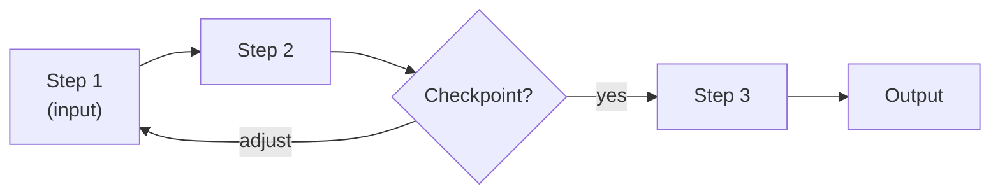

# README 组件语法速查

全部组件在 GitHub 上原生渲染或由官方第三方（shields.io）提供。写作时按需取用，不要照单全收。

## 1. 原生警告框（Alert Callouts）

五种类型，视觉分工建议：NOTE=操作提示 / TIP=凭证与亮点 / IMPORTANT=关键前提 / WARNING=风险 / CAUTION=危险操作。

```markdown
> [!NOTE]
> 安装后在新会话中生效。

> [!TIP]
> [assets/report-sample.md](assets/report-sample.md) 是一次真实运行的完整产出。

> [!IMPORTANT]
> 运行前需要先完成 X。

> [!WARNING]
> 本技能仅提供分析思路，不构成理财、法律或税务建议。

> [!CAUTION]
> 此操作不可逆。
```

技巧：WARNING 框里可以放 `## 标题`，让免责声明既醒目又不占独立版面。

## 2. shields.io 徽章

```markdown
<!-- 静态徽章：License / 规范兼容 / 格式 -->
[](LICENSE)
[](https://agentskills.io)

<!-- 动态徽章：星数 / 最近提交（指向仓库真实状态） -->
[](https://github.com/OWNER/REPO/stargazers)
[](https://github.com/OWNER/REPO/commits/main)
```

- `style=flat-square` 比默认圆角更克制
- 徽章数量 4-6 枚为宜；每枚必须指向真实实体
- 下划线用 `_` 表示空格，竖线用 `%7C`

## 3. mermaid 流程图

```markdown

```

- `LR` 横排适合漏斗/管道；决策用菱形 `{}`
- 节点内换行用 `<br/>`；引号包住含特殊字符的标签
- 上限 7 个节点，只画流程与决策，不画架构全景

## 4. 折叠块

```markdown
<details>
<summary><strong>报告结构（点击展开）</strong></summary>

（前后留空行，内部才能渲染 Markdown）

```markdown
折叠内容
```

</details>
```

## 5. 显式锚点 + 居中 Hero

中文/emoji 标题的自动锚点不可靠，导航链接必须配显式锚点：

```markdown
<div align="center">

# 项目名

**一句话价值主张（EN）**

一句话价值主张（中文）

[徽章排]

```bash
npx skills add owner/repo
```

[Install](#install) · [Usage](#usage) · [Sample](#sample)

</div>

<a id="install"></a>
## Install / 安装
```

## 6. 明暗自适应图（仅当用户真有设计资产时）

```markdown
<picture>
  <source media="(prefers-color-scheme: dark)" srcset="banner-dark.png">
  
</picture>
```

图放仓库内（`assets/`），不放外链图床——README 会比图床活得久。

## 7. 表格窄屏规则

- 手机上 >5 列会碎。关键对照表控制在 2-3 列（对比对象 + 差异）
- 多维信息拆成多个小表或列表，不要做"全能大表"
